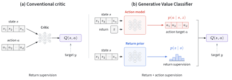

# Generative Value Classifier

[](https://arxiv.org/abs/2610.22497)
[](https://alexanderswerdlow.github.io/gvc/)


[Alexander Swerdlow](https://aswerdlow.com/), [Perry Dong](https://pd-perry.github.io/), [Chelsea Finn](https://ai.stanford.edu/~cbfinn/)  
Stanford University

> [!NOTE]
> Code is coming soon (ETA: end of October)

<p align="center">
  
</p>

We recast value learning as a generative classification problem: a return-conditioned policy scores each action under a set of returns, and these scores form an implicit Q-function.

## Citation

```bibtex
@misc{swerdlow2026gvc,
  title={Generative Value Classifier},
  author={Alexander Swerdlow and Perry Dong and Chelsea Finn},
  year={2026},
  eprint={2610.22497},
  archivePrefix={arXiv},
  primaryClass={cs.LG},
  url={https://arxiv.org/abs/2610.22497}
}
```
